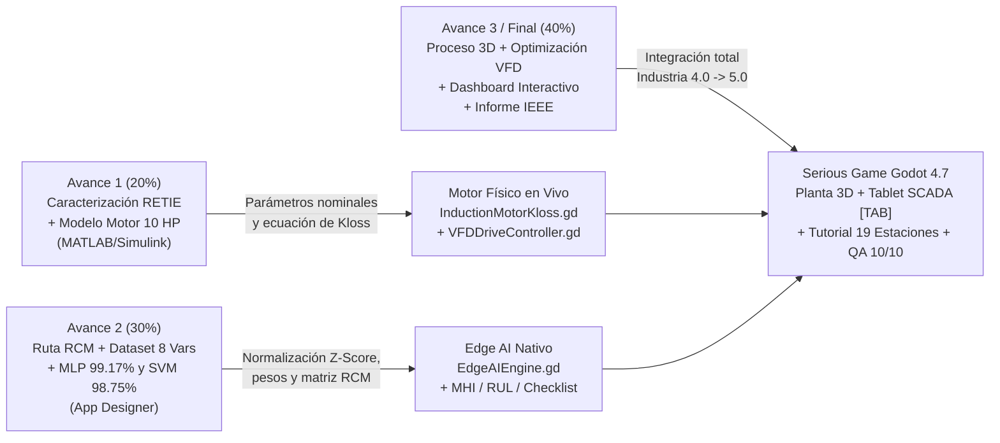
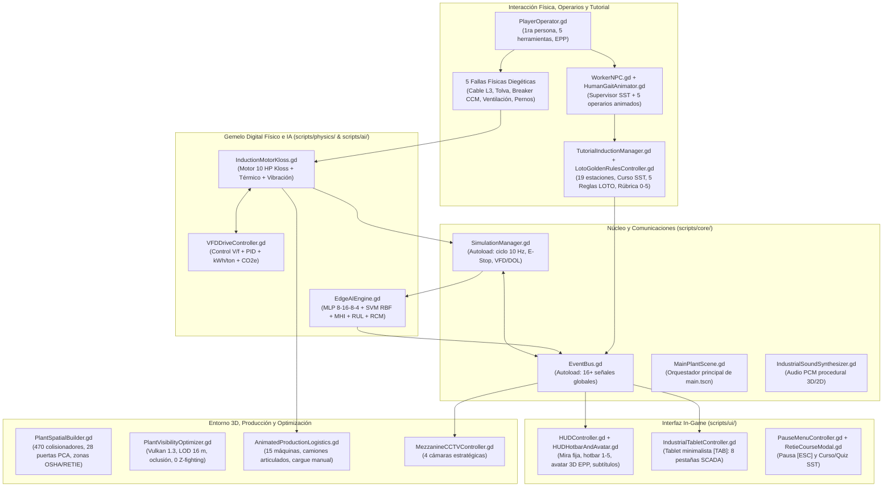

# 📘 Guía Académica y Arquitectura Completa de la Simulación 3D — AgroMolinos del Valle S.A.

**Universidad de los Llanos — Facultad de Ciencias Básicas e Ingeniería**  
**Programa:** Ingeniería Electrónica  
**Asignatura:** Máquinas Eléctricas (2026-2)  
**Docente Titular:** Ing. Lauren Genith Isaza  
**Integrantes:** H. García (161004621) · M. Rodríguez (161004834) · S. Bustamante (161005037)  
**Repositorio Oficial:** [https://github.com/Nocudo/AgroMolinos-Planta-3D](https://github.com/Nocudo/AgroMolinos-Planta-3D)

> Este documento explica de forma integral **(1) la trazabilidad exacta entre cada lineamiento de la guía oficial del curso (`PROYECTO FINAL_MAQUINAS 20262.pdf`) y el simulador interactivo 3D**, y **(2) el funcionamiento interno de cada módulo, física, interacción, interfaz y sistema de verificación** que compone la simulación en **Godot Engine 4.7 (Vulkan 1.3 Forward+)**.

---

## Parte I — Relación Directa entre la Guía del Curso y el Juego

### 1.1 Alineación con la Temática, Subtemática y Enfoque Industria 4.0 → 5.0

La guía oficial establece como eje central la **Transición de Industria 4.0 a Industria 5.0**, con subtemática **Sistema IoT e Inteligencia Artificial**, orientada a la eficiencia energética, la sostenibilidad ambiental (ODS 7, 9 y 12 / Agenda 2030) y el estudio riguroso de las máquinas eléctricas de corriente alterna.

| Dimensión de la Guía Oficial | Materialización en el Simulador 3D (`SimuladorPlantaGodot/`) |
| :--- | :--- |
| **Industria 4.0 (Digitalización, IoT e IA)** | Gemelo digital electromecánico del motor trifásico 10 HP ejecutándose a $10\text{ Hz}$, telemetría True-RMS de 15 máquinas + CCM, red neuronal **MLP ($8 \to 16 \to 8 \to 4$)** y **SVM RBF** embebidos en GDScript, control de velocidad por **VFD escalar V/f con PID** y dashboard SCADA nativo en la **Tablet Industrial (`[TAB]`)**. |
| **Transición a Industria 5.0 (Centrada en el Humano, Resiliente y Sostenible)** | El estudiante **es el operario dentro de la planta**: recibe inducción de seguridad al dialogar con el Supervisor SST, se equipa con **EPP reglamentario 6/6 (RETIE / OSHA)**, aplica en orden estricto las **5 Reglas de Oro LOTO** antes de intervenir circuitos, evalúa riesgos físicos/fisiológicos (IEC 60479-1), opera de manera colaborativa con otros 4 operarios NPC y cuantifica en vivo el ahorro energético ($\text{kWh/ton}$) y las emisiones evitadas ($\text{kg CO}_2\text{e/año}$). |
| **Sector Asignado a): Planta Molino de Granos** | Motor trifásico de inducción jaula de ardilla **$10\text{ HP} - 460\text{ V} - 60\text{ Hz}$ (IE3)** acoplado a un molino de martillos, rodeado de toda la línea productiva real (recepción, bandas, tolva, tornillos sinfín, trituradora, secador rotatorio, ciclones ATEX, horno térmico, intercambiador, soplador, ensacado de $50\text{ kg}$ y despacho en tractocamión articulado). |

---

### 1.2 Matriz de Cumplimiento por Requisito del Sector a) en la Guía

| Requisito Explícito de la Guía (`PROYECTO FINAL_MAQUINAS 20262.pdf`) | Implementación en el Proyecto y el Simulador |
| :--- | :--- |
| **Motor trifásico de inducción jaula de ardilla ($10\text{ HP}, 460\text{ V}$)** | Modelado en `Avance 1/Informe/simulaciones/InductionMachineDTC.slx` (`InductionMachineDTCData.m`) y replicado en tiempo real en `scripts/physics/InductionMotorKloss.gd` ($P_n = 7457\text{ W}$, $V_{LL} = 460\text{ V}$, $f_n = 60\text{ Hz}$, $N_r = 1750\text{ RPM}$, $I_{FLA} = 13.5\text{ A}$, $I_{LRA} = 81.0\text{ A}$, $T_{max} = 101.75\text{ N}\cdot\text{m}$). |
| **Monitoreo de corriente, temperatura y vibración** | Muestreo continuo True-RMS de $I_A, I_B, I_C, IUF, THD$, temperatura de devanado $T_w$ y gradiente $\frac{dT}{dt}$ (aislamiento Clase F), y vibración $Vib_{RMS}, Vib_{peak}$ bajo norma **ISO 10816-3**, graficados en oscilogramas nativos (`TabletOscilloscopeChart.gd`) dentro de la Tablet (`[TAB]`). |
| **Implementar control de velocidad y optimización energética** | Controlador `VFDDriveController.gd` con conmutación en vivo **VFD vs DOL** desde la Tablet, rampa suave de arranque, control PID proporcional al flujo másico de grano y ley cúbica de afinidad ($7.52$ vs $10.50\text{ kWh/ton}$ → **$28.38\%$ de ahorro** y **$488.7\text{ kg CO}_2\text{e/año}$** evitados). |
| **Sistema de alertas para sobrecargas, sobrecalentamiento y fallas** | Motor `EdgeAIEngine.gd` clasifica 4 estados (*Normal*, *Sobrecalentamiento*, *Falla Eléctrica*, *Falla Mecánica*), dispara alertas push sonoras (`AudioAlert`), muestra banners en el HUD y despliega diagnóstico explicable + checklist RCM en la Tablet. |
| **Realizar los planos y entorno en 3D** | Complejo industrial completo en 3D (`planta_completa.glb` derivado de `planta_completa.skp`, `panel_control.glb` y 6 modelos `trabajador_*.glb`), optimizado para **Vulkan 1.3 Forward+** con 470 colisionadores, 28 puertas funcionales y 37 texturas de baja resolución. |

---

### 1.3 Integración de los Tres Cortes Evaluativos dentro del Simulador



1. **Primer Corte — Avance 1 (`20%`): Caracterización y Modelado Electromecánico**
   - *Guía:* Introducir la empresa/sector, caracterizar el motor AC según **RETIE**, adquirir datos de corriente, voltaje, temperatura y vibración, y modelar el motor en MATLAB/Simulink.
   - *En el juego:* La historia y operación de **AgroMolinos del Valle S.A.** se presentan en Portería al conversar con el Supervisor SST; la placa y parámetros exactos de `InductionMachineDTCData.m` gobiernan `InductionMotorKloss.gd`; y las variables eléctricas, térmicas y mecánicas se visualizan en vivo en la Tablet y en los equipos 3D.
2. **Segundo Corte — Avance 2 (`30%`): Mantenimiento Predictivo (RCM) e Inteligencia Artificial**
   - *Guía:* Diseñar la ruta de mantenimiento preventivo/predictivo, implementar un algoritmo de IA (red neuronal o SVM) para clasificar *sobrecalentamiento*, *falla eléctrica* y *falla mecánica*, e integrarlo con un panel de control.
   - *En el juego:* `EdgeAIEngine.gd` ejecuta nativamente en GDScript tanto la red **MLP ($8 \to 16 \to 8 \to 4$)** como el clasificador **SVM RBF** sobre el mismo vector de 8 características del Avance 2, mostrando certezas, causa raíz, pronóstico, ruta RCM interactiva (`CheckBox`) y alertas sonoras en la pestaña **Hardware & IA** de la Tablet.
3. **Tercer Corte — Avance 3 & Proyecto Final (`40%`): Proceso Completo, Optimización Energética y Dashboard Interactivo**
   - *Guía:* Diseñar el sistema completo del proceso asignado, probar estrategias de optimización energética (variadores de frecuencia, control PID, ajustes de carga) y generar un dashboard interactivo con indicadores clave (consumo, eficiencia y estado de salud del motor).
   - *En el juego:* Toda la planta molino de granos opera como un proceso continuo animado en 3D (desde la llegada del camión y molienda hasta el ensacado y despacho), integrando el control **VFD/PID vs DOL**, las métricas de sostenibilidad ($\text{kWh/ton}$ y $\text{kg CO}_2\text{e}$), el **Motor Health Index (MHI)**, la **Vida Útil Remanente (RUL)**, cámaras 3D en vivo y una **rúbrica automática RETIE (`0.0` a `5.0`)**.

---

### 1.4 Cobertura de la Rúbrica Oficial de Evaluación del Proyecto Final

| Criterio de la Rúbrica Oficial | Peso | Cómo el Simulador y el Repositorio Alcanzan el Nivel Alto (`4.9 – 5.0`) |
| :--- | :---: | :--- |
| **Entrega y Cumplimiento de Normatividad (IEEE)** | **20%** | Repositorio versionado en GitHub con informes IEEE en LaTeX (`Avance 1/`, `Avance 2/`), documentación técnica actualizada (`README.md`, este documento, `PLAN_EJECUCION_ARGON.md`) e instalador de 1 clic (`INSTALAR_DEPENDENCIAS.bat`). |
| **Diseño (Fundamento teórico, diagramas, cálculos y simuladores)** | **30%** | Fundamento electromecánico completo (Kloss, Newton-Euler, Arrhenius, ISO 10816-3, IEC 60479-1, RETIE Art. 20, UPME), modelos en MATLAB/Simulink y gemelo digital en Godot 4.7 con correspondencia matemática verificada. |
| **Implementación (Dominio, innovación y funcionamiento correcto)** | **40%** | Prototipo 3D Serious Game funcional en **Vulkan 1.3 Forward+**, fallas 100% físicas diegéticas (cero botones de trampa), IA nativa embebida, Tablet SCADA de 8 pestañas, logística vehicular natural, 37 texturas de baja resolución optimizadas y **suite TDD `headless_verify.gd` aprobando `10/10`**. |
| **Conclusiones y Análisis** | **10%** | Exportación de evidencias cuantitativas (ahorro energético $28.38\%$, reducción de picos de arranque de $81.0\text{ A}$ a $<17.5\text{ A}$, exactitud IA $>98.7\%$ y reporte individual `Reporte_Estudiante_RETIE.json`). |

---

## Parte II — Arquitectura General del Simulador



---

## Parte III — Explicación Detallada de Cada Parte de la Simulación

### 1. Entorno 3D, Motor Vulkan 1.3 Forward+, Texturas de Baja Resolución y Optimización

La escena maestra [`SimuladorPlantaGodot/scenes/main.tscn`](SimuladorPlantaGodot/scenes/main.tscn) integra la planta completa bajo una política estricta de **cero modelos 3D procedurales** (todas las mallas provienen de los `.glb` descargados) combinada con optimización gráfica profunda para correr con alta fluidez incluso en GPUs integradas:

- **API Gráfica Vulkan 1.3 (`Forward Plus`)**: Configurada en `project.godot` con profundidad **Reverse-Z de 32 bits** (eliminando el parpadeo de caras lejanas), cámara `CameraFPS` calibrada (`near = 0.14 m`, `far = 260 m`) y sesgo de sombras (`SunLight`) ajustado para evitar *shadow acne* y *Z-fighting*.
- **Eliminación Total de Texturas Pesadas y Creación de 37 Texturas Procedurales de Baja Resolución**:
  - Todas las texturas antiguas (230 archivos sueltos y 107 imágenes incrustadas de hasta `2048×1536`, mapas normales, ORM y extensión heredada `KHR_materials_pbrSpecularGlossiness`) fueron eliminadas por completo.
  - Se generaron desde cero **37 texturas procedurales limpias** en `SimuladorPlantaGodot/assets/textures_lowres/` (`152.3 KB` totales) e incrustadas en los 8 `.glb` con `gltf/embedded_image_handling=2` (**Basis Universal**, compresión hardware en VRAM):
    - **32 texturas `64×64` sin costuras** para lámina corrugada (gris, blanca, amarilla, verde), aluminio anodizado, acero oscuro, piso metálico, bloque de concreto, concreto, estuco, adoquín, baldosa, azulejo, césped, grava, ladrillo, madera, tela de saco, malla metálica con canal alfa, vidrio azulado y acero/polímero del tablero CCM.
    - **5 uniformes `128×128`** horneados directamente desde las coordenadas 3D `(X, Y, Z)` de la malla del trabajador sobre su espacio UV (`worker_civil.png`, `worker_epp.png`, `worker_sst.png`, `worker_mantenimiento.png`, `worker_jefe_planta.png`), diferenciando visualmente casco, rostro, franjas reflectivas, guantes y botas por rol.
  - **Reducción medida en disco y VRAM**: `panel_control.glb` bajó de `11.13 MB` a `2.06 MB` (**−99.9%** en texturas), `planta_completa.glb` redujo sus texturas incrustadas de `3.31 MB` a `79.3 KB` (**−97.6%**) y los 6 modelos de trabajadores bajaron de `29.61 MB` a `16.92 MB` (**−99.3%** en texturas).
- **Construcción Espacial, Colisiones y Alineación Milimétrica de Puertas (`PlantSpatialBuilder.gd` + `InteractiveDoor.gd`)**:
  - Genera el suelo físico industrial `SueloFisicoPBR` (`StaticBody3D` sólido con fricción $0.85$) y **470 colisionadores** sobre paredes, losas, pasarelas, silos y maquinaria.
  - Detecta y convierte las **28 puertas y portones** de la planta en nodos interactivos (`InteractiveDoor.gd`: batientes simples, dobles, enrollables y portones corredizos automáticos). Las 23 puertas batientes y dobles se alinean automáticamente al plano exacto del marco mediante **PCA 2D de vértices** y ajuste de jamba (`error angular = 0.000°`, `error posicional <= 0.01 mm`, giro limpio de `90°`).
  - Traza en piso las **zonas de seguridad industrial** (`FloorDecal` sin Z-fighting): Zona 1 Molienda (amarillo/negro OSHA), Zona 2 CCM 460 V (rojo $1.0\text{ m}$ RETIE Art. 20 / NFPA 70E), Pasillos Peatonales (verde), Recepción (azul), Almacén (blanco) y Atmósfera de Polvo Combustible (ATEX Zona 22 / NFPA 61).
- **Optimización Espacial (`PlantVisibilityOptimizer.gd`)**:
  - Convierte materiales sólidos de SketchUp con `alphaMode=MASK` innecesario a opacos reales (habilitando *Early-Z*), reemplaza la malla alfa multicapa de los lockers por material opaco optimizado, elimina mallas duplicadas coplanares y agrupa geometría estática en **celdas espaciales de $16\text{ m}$ por bandas LOD** (`MICRO`, `SMALL`, `MEDIUM`) más oclusión Este/Oeste y *culling* de camiones lejanos (`> 68 m`), reduciendo los *draw calls* en la nave de `1,562` a `~351`.

---

### 2. Gemelo Electromecánico del Motor de 10 HP y Optimización Energética (VFD vs DOL)

Implementado en [`InductionMotorKloss.gd`](SimuladorPlantaGodot/scripts/physics/InductionMotorKloss.gd) y [`VFDDriveController.gd`](SimuladorPlantaGodot/scripts/physics/VFDDriveController.gd), ejecuta la física continua del motor crítico `M-101` en cada paso `_physics_process(dt)`:

1. **Par Electromecánico (Fórmula de Kloss con relación $V/f$)**:
   $$T_e(s, V_{LL}, f_{op}) = T_{max} \cdot \left(\frac{V_{LL} / 460.0}{f_{op} / 60.0}\right)^2 \cdot \frac{2}{\frac{s}{s_{max}} + \frac{s_{max}}{s}}$$
   con $T_{max} = 101.75\text{ N}\cdot\text{m}$, $s_{max} = 0.15$ y velocidad sincrónica $N_s = \frac{120 f_{op}}{4}$.
2. **Dinámica Rotacional de Newton-Euler**:
   $$\frac{d\omega_m}{dt} = \frac{T_e - T_{load}(\dot{m}) - B\omega_m - T_{jam}}{J_{total}}$$
   donde $J_{total} = 0.35\text{ kg}\cdot\text{m}^2$ y $T_{load}$ crece con el flujo másico de cereal $\dot{m}$ ($\text{kg/s}$) proveniente de la tolva.
3. **Modelo Térmico del Devanado (Aislamiento Clase F — $155^\circ\text{C}$)**:
   - Calcula pérdidas en cobre ($I^2 R$), hierro y fricción, integrando la temperatura $T_w$ con capacitancia térmica $C_{th} = 185\text{ J/}^\circ\text{C}$ y resistencia térmica $R_{th,nom} = 0.068^\circ\text{C/W}$ (sano) o $R_{th,obs} = 0.210^\circ\text{C/W}$ (rejilla obstruida), emitiendo además el gradiente $\frac{dT}{dt}$.
4. **Corrientes Trifásicas, Desbalance ($IUF$), Armónicos ($THD$) y Vibración (ISO 10816-3)**:
   - En estado nominal a plena carga: $N_r \approx 1750\text{ RPM}$, $I_A \approx I_B \approx I_C \approx 13.5\text{ A}$, $IUF < 2\%$, $Vib_{RMS} \approx 1.1\text{ mm/s}$ (Zona A).
   - Bajo pérdida de fase L3: $I_C = 0\text{ A}$, sobrecorriente en L1/L2 ($\times \sqrt{3}$), $IUF > 25\%$ y vibración pulsante a $120\text{ Hz}$.
5. **Estrategia Energética DOL vs VFD (`VFDDriveController.gd`)**:
   - **Modo DOL**: Frecuencia fija a $60\text{ Hz}$, pico de arranque $I_{LRA} = 81.0\text{ A}$, consumo específico base de **$10.50\text{ kWh/ton}$**.
   - **Modo VFD (V/f + PID)**: Rampa suave de aceleración (limitando corriente de arranque), regulación automática de frecuencia según carga de grano (ley cúbica de afinidad $P \propto (f_2/f_1)^3$ verificada a $42\text{ Hz}$), consumo específico de **$7.52\text{ kWh/ton}$** (**$28.38\%$ de ahorro**) y mitigación de **$488.7\text{ kg CO}_2\text{e/año}$** (factor UPME Colombia $0.164\text{ kg CO}_2\text{e/kWh}$).

---

### 3. Inteligencia Artificial Edge Nativa y Mantenimiento Predictivo RCM

Implementado en [`EdgeAIEngine.gd`](SimuladorPlantaGodot/scripts/ai/EdgeAIEngine.gd) sin requerir servidores externos ni navegadores:

- **Entrada (Vector de 8 Características a $10\text{ Hz}$)**:
  $$\mathbf{x} = \begin{bmatrix} I_{RMS} & IUF & THD & V_{RMS} & T_w & \frac{dT}{dt} & Vib_{RMS} & Vib_{peak} \end{bmatrix}^T$$
- **Doble Clasificador Embebido**:
  - **MLP ($8 \to 16 \to 8 \to 4$)** con normalización Z-Score, activaciones ReLU y salida Softmax.
  - **SVM Multiclase con kernel RBF** ($\gamma = 0.125, C = 10.0$) para contraste de confianza en tiempo real.
- **Salidas de Diagnóstico y Pronóstico**:
  - **Clase predicha** (`NORMAL`, `SOBRECALENTAMIENTO`, `FALLA_ELECTRICA`, `FALLA_MECANICA`) y nivel de severidad (`NORMAL`, `WARNING`, `CRITICAL`).
  - **Motor Health Index (MHI, $0–100\%$)** ponderando estado térmico, severidad vibratoria ISO 10816-3 y desbalance $IUF$.
  - **Remaining Useful Life (RUL, en horas)** modelada por degradación térmica de Arrhenius en aislamiento Clase F y fatiga mecánica en rodamientos.
  - **Prescripción RCM / RETIE**: Causa raíz, pronóstico, acción correctiva y lista de pasos interactivos (`maintenance_steps`) enviada por `EventBus.ai_alert_received` a la Tablet.

---

### 4. Inducción Diegética de las 5 Fallas Físicas y Reparación en Campo

Siguiendo la regla cardinal de **cero botones de inyección de fallas en UI**, las 5 fallas se provocan y reparan físicamente en el mundo 3D:

| # | Falla Física | Script / Nodo 3D | Herramienta | Acción Física de Inducción | Efecto Electromecánico y Respuesta IA | Reparación Física en 3D |
| :-: | :--- | :--- | :---: | :--- | :--- | :--- |
| **1** | **Corte de Fase L3 (Monofasización)** | `PhysicalCableConductor.gd` | `2` Alicates | Cortar el conductor L3 en el motor (`E`/Clic) | Arco eléctrico + audio, $I_C = 0\text{ A}$, $IUF > 25\%$, $Vib > 4.5\text{ mm/s}$ → IA: `FALLA_ELECTRICA` | Aplicar LOTO y empalmar nuevamente el conductor con `2` Alicates |
| **2** | **Atasco / Rotor Bloqueado en Tolva** | `PhysicalHopperFeeder.gd` + `InteractiveGrainBag.gd` | `1` Manos | Cargar y arrojar $\ge 2$ sacos de $50\text{ kg}$ en la tolva | $\dot{m} \ge 3\text{ kg/s}$, $T_L > T_{max}$, $N_r < 50\text{ RPM}$, $I_a > 70\text{ A}$ → IA: `SOBRECALENTAMIENTO` | Interactuar en la boca de la tolva para desatascar el grano |
| **3** | **Bajón de Tensión (*Voltage Sag*) en CCM** | `PhysicalBreakerPanel.gd` | `1` Manos / `5` LOTO | Manipular breaker L3 en el tablero `panel_control.glb` | $V_{LL}: 460\text{ V} \to 340\text{ V}$, caída cuadrática de par ($T_e \propto V^2$), resaltado rojo de falla | Rearmar la palanca del breaker a $460\text{ V}$ |
| **4** | **Obstrucción de Ventilación Trasera** | `VentilationCover.gd` | `1` Manos | Obstruir la rejilla trasera del ventilador del motor | $R_{th}: 0.068 \to 0.210^\circ\text{C/W}$, aumento rápido de $\frac{dT}{dt}$ y $T_w > 105^\circ\text{C}$ → IA: `SOBRECALENTAMIENTO` | Retirar la obstrucción limpiando la rejilla |
| **5** | **Soltura de Pernos de Bancada** | `MechanicalBolt.gd` | `3` Llave `3/4"` | Aflojar pernos de anclaje del motor 10 HP | Excentricidad y armónicos 1X/2X RPM, $Vib_{RMS} > 3.5\text{ mm/s}$ (Zona C/D) → IA: `FALLA_MECANICA` | Reapretar los pernos con `3` Llave `3/4"` |

---

### 5. Cadena de Producción Animada y Logística Vehicular

Controlada por [`AnimatedProductionLogistics.gd`](SimuladorPlantaGodot/scripts/production/AnimatedProductionLogistics.gd) en `ProductionChainFlow.tscn`:

- **Proceso Productivo de 15 Máquinas + CCM**: Sincroniza la rotación del tornillo sinfín helicoidal (eje X longitudinal), la eficiencia de línea, los flujos de partículas de grano/harina y la producción acumulada de masa molida ($\text{kg}$), sacos de $50\text{ kg}$ y pallets con las RPM reales del motor (`rpm == 0` detiene la línea).
- **Camiones Articulados en Vías Pavimentadas**:
  - Dos circuitos vehiculares (`TruckIntakeMover` y `TruckDispatchMover` / `TruckBay2Mover`) con conductores en cabina (`TruckCabDriver`) y audio 3D de motor diésel, alarma de reversa, frenos neumáticos y bocina.
  - Circulan estrictamente sobre las vías pavimentadas (`ADOQUIN` / `baldosa`), activando automáticamente los portones corredizos (`Door_Porton Automatico Parcela`).
  - El tractocamión articulado realiza giros naturales (`max_bend = 42°`) manteniendo el semirremolque acoplado permanentemente a la quinta rueda (sin inclinación ni separación) y se parquea al ras frente a la **puerta amarilla izquierda** de despacho, con cero *glow* artificial.
- **Cargue Manual de Sacos por Operarios**:
  - Los sacos ya no tienen brillo ni se desplazan solos por el aire.
  - Los operarios de logística y muelle (`WorkerLogistics`, `WorkerDockSouth`) ejecutan una animación biomecánica de caminata con carga (`HumanGaitAnimator.gd`, modo `carry_walk` con brazos flexionados sosteniendo el saco al frente) para llevar los bultos de $50\text{ kg}$ al camión **únicamente cuando el camión está físicamente parqueado en la puerta izquierda**.

---

### 6. Modo Tutorial RETIE, Recorrido Seguro de 19 Estaciones y Operarios NPC

Gestionado por [`TutorialInductionManager.gd`](SimuladorPlantaGodot/scripts/tutorial/TutorialInductionManager.gd), [`LotoGoldenRulesController.gd`](SimuladorPlantaGodot/scripts/tutorial/LotoGoldenRulesController.gd), [`RetieCourseModal.gd`](SimuladorPlantaGodot/scripts/ui/RetieCourseModal.gd) y [`WorkerNPC.gd`](SimuladorPlantaGodot/scripts/interactive/WorkerNPC.gd):

- **Apertura Exclusiva al Hablar con el Supervisor SST**: Al iniciar en Portería (o al llegar a la Sala de Reuniones), **ningún menú ni el Curso SST / Quiz RETIE se abre automáticamente**; el jugador debe acercarse y presionar `E` / Clic sobre **Carlos Mendoza (Supervisor SST)**. Primero se presenta la historia de **AgroMolinos del Valle S.A.** y luego el recorrido guiado.
- **Vestidores y Enclavamiento EPP (`6/6`)**: `LockerEPPStation.gd` bloquea el avance hacia las estaciones productivas hasta equipar las 6 prendas reglamentarias, momento en el cual cambia en tiempo real la indumentaria del jugador y del avatar 3D del HUD (`SIN EPP` → `EPP 6/6 OK`).
- **5 Reglas de Oro LOTO**: `LotoGoldenRulesController.gd` exige el orden estricto `1 → 2 → 3 → 4 → 5` (rechaza cualquier paso fuera de secuencia).
- **19 Estaciones Verificadas sin Colisiones (`TourFloorGuideLine`)**:
  1. Portería → 2. Vestidores EPP → 3. Zona de Carga y Banda de Descarga (01) → 4. Banda Inclinada (02) → 5. Tolva T-301 (03) → 6. Banda Trituradora (04) → 7. Tornillo Trituradora (05) → 8. Trituradora y Motor 10 HP (06) → 9. Tornillo Secador (07) → 10. Tablero CCM 460 V (LOTO) → 11. Secador Rotatorio (08) → 12. Ciclón Separador (09) → 13. Ciclones Clasificadores ATEX (10) → 14. Almacén de Sacos 50 kg → 15. Intercambiador de Calor (14) → 16. Horno Térmico (12) → 17. Unidad de Extracción (11) → 18. Soplador (13) → 19. Ductos de Aire (15) y cierre exterior.
  - Durante la explicación, la máquina activa se resalta con un brillo azul parpadeante no intrusivo (`InteractableGlowController.gd`).
- **Personal NPC en Planta**: Supervisor SST (`WorkerSafetyAuditor`), Electricista (`WorkerElectrician`), Operario Logístico (`WorkerLogistics`), Jefe de Planta (`WorkerPlantManager`) y señaleros de muelle (`WorkerDockSouth`, `WorkerDockWest`), cada uno con uniforme `128×128` propio, caminata biomecánica y subtítulos limpios sin sufijos redundantes de ubicación.

---

### 7. Control del Jugador, HUD Minimalista y Menú de Pausa

Implementado en [`PlayerOperator.gd`](SimuladorPlantaGodot/scripts/interactive/PlayerOperator.gd), [`HUDController.gd`](SimuladorPlantaGodot/scripts/ui/HUDController.gd), [`HUDHotbarAndAvatar.gd`](SimuladorPlantaGodot/scripts/ui/HUDHotbarAndAvatar.gd) y [`PauseMenuController.gd`](SimuladorPlantaGodot/scripts/ui/PauseMenuController.gd):

- **Primera Persona Fija y Navegación Fluida**: Cápsula ergonómica (`radius <= 0.35 m`) para cruzar puertas interiores sin trabarse, cabeza oculta en primera persona, sin cámara en tercera persona y *auto-step* (`>= 0.80 m`) para subir rampas y escalones con suavidad.
- **HUD Limpio y Sin Distracciones**:
  - **Mira central fija**: Cruz blanca (`+`, `14×2 px`) con borde negro fino de `1 px` que nunca cambia de color.
  - **Sin botón flotante «Saltar tutorial»** en pantalla.
  - **Ubicación superior permanente** de la zona actual y **subtítulos naturales** de operarios centrados encima de la hotbar (`[Nombre] ([Cargo]): ...`).
  - **Hotbar inferior de 5 herramientas** (`1: Manos`, `2: Alicates`, `3: Llave 3/4"`, `4: Multímetro`, `5: Kit LOTO`) acompañada del **avatar 3D en vivo** con estado `SIN EPP` / `EPP 6/6 OK`.
- **Menú de Pausa (`[ESC]`)**: Permite reanudar, reiniciar, ajustar independientemente el volumen de los buses `Master`, `SFX` y `Ambience`, y consultar la guía rápida de teclas.

---

### 8. Tablet Industrial SCADA Minimalista (`[TAB]`) — Sus 8 Pestañas

Implementada en [`IndustrialTabletController.gd`](SimuladorPlantaGodot/scripts/ui/IndustrialTabletController.gd), [`TabletChassisVisuals.gd`](SimuladorPlantaGodot/scripts/ui/TabletChassisVisuals.gd) y sus módulos auxiliares (`TabletOscilloscopeChart.gd`, `Tablet3DViewportCard.gd`, `TabletSecondaryTabsBuilder.gd`, `TabletAnalyticalCanvases.gd`, `TabletDataCatalog.gd`, `TabletThemeHelper.gd`):

- **Diseño Limpio e Invariante**: Marco minimalista oscuro de `1228×748` con pantalla interior de `1180×700`, bordes suavizados con antialiasing GPU y sombra ambiental; **sin botones ficticios decorativos ni botón «Salir»** (se abre y cierra con **`TAB`** o **`ESC`**).
- **Encabezado Funcional**: Título `AGROMOLINOS SCADA`, píldora de estado en vivo (`Normal` / `Alerta` / `Falla crítica` / `Parada`), nota académica (`RETIE 5.0/5.0`) y botón exclusivo **`Parar Máquinas` / `Reanudar Máquinas`** (única parada de emergencia del simulador).
- **Las 8 Pestañas Nativas In-Game**:
  1. **`Monitoreo IoT`**: Barra de estado CCM/VFD, conmutador **Modo VFD / DOL**, botón de silencio de alertas, filtro de zonas (`Todas`, `Recepción`, `Molienda`, `Ciclones`, `Aire y CCM`), tarjetas con **oscilogramas en tiempo real** para las **15 máquinas + CCM** (incluidos los 3 oscilogramas principales del motor 10 HP: Corrientes $I_a/I_b/I_c$, Temperatura $T_w$ y Vibración RMS) y caja negra (*Blackbox*) cronológica de eventos.
  2. **`Cámaras`**: 24 visores 3D interactivos en vivo (20 cámaras de planta: 15 máquinas + CCM + vistas generales, más los 4 operarios en planta), agrupados por sector con renderizado optimizado bajo demanda.
  3. **`RETIE`**: Estado en tiempo real de las **5 Reglas de Oro** (`Pendiente` / `Lista`), tarjetas resumen del Motor 10 HP, CCM/VFD y EPP (`0/6` a `6/6`), más tabla normativa de riesgos eléctricos RETIE.
  4. **`Operarios`**: Estado del operario jugador (estación actual, EPP y nota), ficha del personal en turno y formulario interactivo para registrar operarios adicionales en turno.
  5. **`Riesgos`**: Matriz técnica y gráficas analíticas de riesgos eléctricos, mecánicos, térmicos y atmósferas explosivas ATEX.
  6. **`Fisiología IEC`**: Curvas interactivas de los efectos fisiológicos de la corriente alterna en el cuerpo humano según **IEC 60479-1** (zonas AC-1 a AC-4).
  7. **`Hardware & IA`**: Diagnóstico en tiempo real del motor **Edge AI** (certeza MLP y SVM), barra de **Motor Health Index (MHI)**, contador de **Vida Útil Remanente (RUL)**, causa raíz, pronóstico, prescripción y **checklist RCM interactivo** con casillas verificables.
  8. **`Rúbrica`**: Calificación RETIE continua (`0.0 / 5.0`), historial de infracciones y bonificaciones, y tablero de avance por cada una de las **19 estaciones** del recorrido.

---

### 9. Síntesis de Audio Industrial 3D/2D (`IndustrialSoundSynthesizer.gd`)

Para mantener el repositorio liviano y autocontenido sin depender de bancos de audio externos pesados, [`IndustrialSoundSynthesizer.gd`](SimuladorPlantaGodot/scripts/core/IndustrialSoundSynthesizer.gd) sintetiza en memoria flujos PCM normalizados (`AudioStreamWAV`) para toda la planta:
- Zumbido electromagnético del motor de 10 HP (`MotorHumAudio3D`), chasquido de breakers CCM (`AudioClick`), arco eléctrico 460 V (`AudioArc`), flujo de grano (`AudioFeed`), pasos del operario (`FootstepAudio`), pestillos y motores de portones (`DoorAudio`), ambiente general de planta (`PlantAmbienceAudio`), audio completo de camiones (diésel, alarma de reversa, freno neumático y bocina) y tono característico de notificación push de la Tablet (`AudioAlert`).

---

### 10. Evaluación Académica Continua RETIE (`SafetyEvaluationScorecard.gd`)

- **Nota Base**: `5.0 / 5.0`, visible en el encabezado y la pestaña **Rúbrica** de la Tablet.
- **Penalizaciones por Actos Inseguros**:
  - Entrar sin casco dieléctrico (`-0.8`), sin botas dieléctricas (`-1.0`), sin protección auditiva en zona de molienda (`-0.6`), invadir el perímetro rojo de $1.0\text{ m}$ del CCM sin guantes (`-1.5`), intervenir el molino en giro (`-2.5`) o cortar cables sin LOTO (`-3.0`).
- **Bonificaciones**: Completar las 5 Reglas de Oro LOTO (`+1.0`) y resolver fallas siguiendo la ruta diagnóstica de la Tablet (`+1.0`).
- **Evidencia Exportable**: Genera un reporte estructurado en JSON (`user://Reporte_Estudiante_RETIE.json`) con nota final e historial completo de eventos.

---

### 11. Verificación Autónoma Headless (`headless_verify.gd` — 10/10 Checkpoints)

El simulador incluye una suite automatizada de 10 pruebas integrales ejecutable desde consola sin ventana gráfica:

```powershell
godot --headless --audio-driver Dummy --path SimuladorPlantaGodot --script res://scripts/tests/headless_verify.gd
```

| Checkpoint | Qué Certifica Automáticamente |
| :---: | :--- |
| **QA 1/10** | Carga sin errores de las **16 escenas `.tscn`** y las **16 señales obligatorias** de `EventBus`. |
| **QA 2/10** | Física de **Kloss 10 HP** ($1740–1780\text{ RPM}$, $I_a \in [11.5, 15.5]\text{ A}$, $T_{max}=101.75$, $I_{LRA}=81.0\text{ A}$), ley cúbica a $42\text{ Hz}$ y KPIs VFD vs DOL (`7.52` vs `10.50 kWh/ton`, ahorro $>28\%$, UPME `0.164`). |
| **QA 3/10** | Enclavamiento de Vestidores EPP `6/6`, línea guía `TourFloorGuideLine`, orden estricto `1→5` de LOTO y certificación de las **19 estaciones**. |
| **QA 4/10** | Cadena de producción animada sincronizada con RPM (rotación del sinfín eje X, masa molida, sacos de $50\text{ kg}$ y ciclo de camiones). |
| **QA 5/10** | Inducción y reparación física de las **5 fallas diegéticas** (corte L3, atasco tolva, sag CCM 340 V, ventilación obstruida y pernos flojos). |
| **QA 6/10** | Motor **Edge AI** nativo (`NORMAL`, `SOBRECALENTAMIENTO`, `FALLA_ELECTRICA` $>95\%$, `FALLA_MECANICA`, MHI, RUL y checklist RCM). |
| **QA 7/10** | **Tablet Industrial `[TAB]`**: tamaño invariante `1228×748 / 1180×700`, ausencia total de botones ficticios y de `BtnClose` («Salir»), 8 pestañas, 3 oscilogramas principales, 16 activos IoT y 24 cámaras 3D. |
| **QA 8/10** | Controlador **CCTV Mezzanine** (4 cámaras) y **Rúbrica RETIE** (`5.0 → 2.0 → 3.0`) con exportación y lectura válida de JSON. |
| **QA 9/10** | Auditoría estricta de **cero primitivas 3D prohibidas** (`CSG`, `BoxMesh`, `CylinderMesh`, etc.) en las 16 escenas y presencia de los `.glb` descargados. |
| **QA 10/10** | Integración completa de `scenes/main.tscn`: 470 colisionadores, 28 puertas interactivas funcionales, 0 cruces de línea guía por muros, audio PCM normalizado, flujo de bienvenida/Curso SST activado solo al hablar con el Supervisor SST, mira fija y verificación end-to-end de alertas. |

---

## Parte IV — Inventario Técnico de Escenas y Módulos del Simulador

| Carpeta | Archivos Principales | Responsabilidad en la Simulación |
| :--- | :--- | :--- |
| `scenes/` | `main.tscn` + 15 subescenas en `environment/`, `equipment/`, `infrastructure/`, `player/`, `production/`, `ui/`, `workers/` | Composición modular de la planta, equipos interactivos, jugador, operarios e interfaces. |
| `scripts/core/` | `EventBus.gd`, `SimulationManager.gd`, `MainPlantScene.gd`, `IndustrialSoundSynthesizer.gd`, `CloudIoTBridge.gd` | Bus global de eventos, lazo de simulación a 10 Hz, parada de emergencia y síntesis de audio PCM. |
| `scripts/physics/` | `InductionMotorKloss.gd`, `VFDDriveController.gd` | Gemelo electromecánico del motor de 10 HP, dinámica térmica/vibratoria y control VFD/PID vs DOL. |
| `scripts/ai/` | `EdgeAIEngine.gd` | Clasificación MLP + SVM RBF, cálculo de MHI/RUL y prescripción RCM. |
| `scripts/environment/` | `PlantSpatialBuilder.gd`, `PlantVisibilityOptimizer.gd`, `MezzanineCCTVController.gd` | Colisiones, zonas OSHA/RETIE, alineación PCA de puertas, batching LOD Vulkan 1.3 y CCTV. |
| `scripts/production/` | `AnimatedProductionLogistics.gd` | Flujo productivo de 15 máquinas, camiones articulados en vías pavimentadas y cargue manual de sacos. |
| `scripts/interactive/` | `PlayerOperator.gd`, `WorkerNPC.gd`, `HumanGaitAnimator.gd`, `InteractiveDoor.gd`, `LockerEPPStation.gd`, `InteractableGlowController.gd` y los 6 scripts de equipos/fallas | Control en 1ra persona, animación biomecánica de operarios, puertas, EPP y las 5 fallas físicas diegéticas. |
| `scripts/tutorial/` | `TutorialInductionManager.gd`, `LotoGoldenRulesController.gd`, `SafetyEvaluationScorecard.gd` | Recorrido seguro de 19 estaciones, 5 Reglas de Oro LOTO y rúbrica RETIE (`0.0–5.0`). |
| `scripts/ui/` | `HUDController.gd`, `HUDHotbarAndAvatar.gd`, `PauseMenuController.gd`, `RetieCourseModal.gd`, `IndustrialTabletController.gd` y 7 módulos `Tablet*.gd` | HUD limpio con mira fija, avatar 3D EPP, pausa, Curso/Quiz SST y Tablet SCADA de 8 pestañas. |
| `assets/` | `models/*.glb` (8 modelos) y `textures_lowres/*.png` (37 texturas `64×64` / `128×128`) | Geometría 3D descargada optimizada con texturas procedurales de baja resolución y compresión Basis Universal. |
| `scripts/tests/` | `headless_verify.gd` | Suite maestra automatizada de certificación `10/10 PASS`. |
