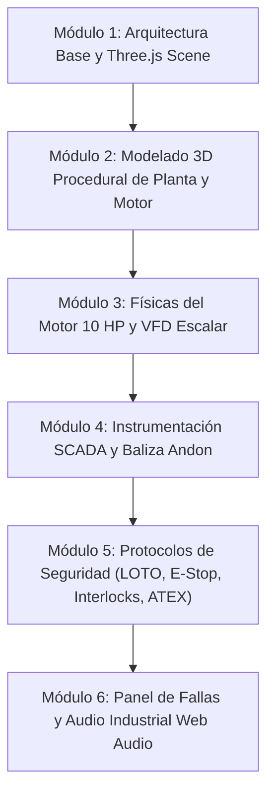

# Plan Maestro: Simulador Interactivo 3D de Planta Industrial (Molino de Granos) en Three.js

**Proyecto:** Máquinas Eléctricas (Universidad de los Llanos — 2026-2)  
**Entorno Operativo:** Planta AgroMolinos del Valle S.A.  
**Equipo Crítico:** Motor Trifásico de Inducción Jaula de Ardilla (10 HP, 460 V, 60 Hz, 4 polos, 1750 RPM nominales) accionado por Variador de Frecuencia (VFD).  
**Marco Normativo de Seguridad:** RETIE (Art. 13, 20), NFPA 70E (Seguridad Eléctrica en Lugares de Trabajo), ISO 13857 (Distancias de seguridad), ISO 10816-1/3 (Severidad de Vibración en Maquinaria), NFPA 61 / ATEX (Atmósferas explosivas por polvo de granos), OSHA 1910.147 / 5 Reglas de Oro (LOTO).  
**Motor Gráfico:** **Three.js (WebGL / WebGPU)** — Ejecución autónoma en navegador sin compiladores externos ni dependencias pesadas.

---

## 1. Visión General del Proyecto

Desarrollar una aplicación web interactiva 3D con Three.js que combine:
1. **Modelado Procedural 3D de la Planta**: Nave industrial, tolva, molino de martillos, silo de grano, tornillo sinfín, motor de inducción con aletas y eje móvil, y tablero eléctrico CCM.
2. **Modelo Multifísico en Tiempo Real**: Ecuaciones de Kloss para par/deslizamiento, cálculo de corriente trifásica dependiente de la carga, modelo térmico diferencial de primer orden para calentamiento estatórico y modelo de vibración ISO 10816-3.
3. **Protocolos de Seguridad Industrial Interactivos**:
   - Parada de emergencia (E-Stop, Cat 0 IEC 60204-1).
   - Procedimiento LOTO interactivo con candado físico, tarjeta de seguridad y seccionador de cuchillas en el CCM.
   - Microswitch de seguridad en la compuerta del molino (Interlock).
   - Simulación de polvo combustible de cereales en suspensión (ATEX / NFPA 61) con extractor de ciclón.
4. **Telemetría SCADA / HMI Industrial**: Panel frontal superpuesto en HTML5/CSS con instrumental analógico y digital (voltímetros, amperímetros, tacómetro, termómetro de devanados, frecuencímetro VFD y acumulador de energía en kWh).
5. **Baliza Andon ISA 18.2**: Torre de luces 3D y notificación en pantalla de 4 estados (Verde, Amarillo, Rojo, Azul).
6. **Inyector de Fallas Pedagógicas**: Panel de control para inducir sobrecarga/atasco, pérdida de una fase (L3), desgaste de rodamientos y falla de ventilación forzada.

---

## 2. Mapa de Módulos (Roadmap de Desarrollo)

---

### Módulo 1: Arquitectura Base y Escena Three.js
- [x] Configuración de estructura web (`index.html`, `css/`, `src/`).
- [ ] Importación de Three.js y OrbitControls / PointerLockControls vía ES Modules (CDN).
- [ ] Pipeline de iluminación PBR (DirectionalLight con sombras suaves, AmbientLight y materiales metálicos/rugosos).
- [ ] Soporte para doble modo de cámara: **Modo Inspector (Orbital)** y **Modo Operario (Primera Persona WASD)**.

### Módulo 2: Modelado 3D Procedural de la Planta y Maquinaria
- [ ] Nave industrial (pisos de concreto, paredes, vigas de acero estructural, demarcación de zonas RETIE en amarillo/negro).
- [ ] Motor Trifásico de Inducción 10 HP (carcasa con aletas de refrigeración, caja de bornes, eje y ventilador giratorio acoplado a las RPM calculadas).
- [ ] Molino de martillos con tolva de alimentación superior y compuerta de inspección abatible.
- [ ] Elevador de grano / Tornillo sinfín de descarga.
- [ ] Tablero eléctrico CCM con seccionador rotativo, botonera y torre de baliza Andon.

### Módulo 3: Físicas del Motor 10 HP y VFD
- [ ] Implementación de la fórmula de Kloss para par electromagnético en función del deslizamiento.
- [ ] Control escalar V/f con rampa de aceleración/desaceleración configurable ($0$ a $60\text{ Hz}$).
- [ ] Cálculo de corriente trifásica ($I_{RMS}$) y factor de potencia ($\cos\phi$).
- [ ] Integración numérica diferencial para temperatura de bobinado ($T_{dev}$) considerando pérdidas Joule y ventilación forzada.
- [ ] Cálculo de vibración RMS clasificada según ISO 10816-3.

### Módulo 4: Instrumentación SCADA / HMI
- [ ] Tacómetro digital (RPM).
- [ ] Amperímetros de aguja y display digital para fases L1, L2, L3.
- [ ] Frecuencímetro VFD con potenciómetro interactivo.
- [ ] Indicador térmico con zona de advertencia ($> 85^\circ\text{C}$) y disparo crítico ($> 105^\circ\text{C}$).
- [ ] Baliza Andon 3D y 2D (Verde = Normal, Amarillo = Alerta, Rojo = Falla/E-Stop, Azul = LOTO).

### Módulo 5: Protocolos de Seguridad (LOTO, E-Stop, Interlocks, ATEX)
- [ ] Botón de Parada de Emergencia tipo hongo con enclave y rearme.
- [ ] Flujo de bloqueo y etiquetado LOTO con candado físico y tarjeta de peligro interactivos.
- [ ] Microswitch de seguridad en la compuerta del molino (disparo inmediato si se abre con $N > 0$).
- [ ] Nube de partículas WebGL de polvo combustible de cereal con sensor de concentración $g/m^3$ y ciclón de extracción.

### Módulo 6: Panel de Fallas y Audio Industrial
- [ ] Inyección de atasco mecánico / sobrecarga por alimentación excesiva.
- [ ] Inyección de caída de fase (desbalance trifásico).
- [ ] Inyección de falla de rodamiento (elevación de vibración a Zona D).
- [ ] Síntesis de sonido procedural con Web Audio API (zumbido 60 Hz/RPM, inversor PWM y sirena ISA 18.2).
