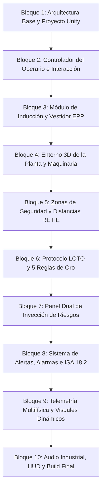

# Plan Maestro: Simulador Interactivo 3D de Planta Industrial (Molino de Granos) en Unity

**Proyecto:** Máquinas Eléctricas (Universidad de los Llanos — 2026-2)  
**Entorno Operativo:** AgroMolinos del Valle S.A.  
**Equipo Crítico:** Motor Trifásico de Inducción Jaula de Ardilla (10 HP, 460 V, 60 Hz, 4 polos, 1750 RPM) accionado por VFD  
**Marco Normativo de Seguridad:** RETIE (Art. 13, 20), NFPA 70E (Arc Flash), ISO 13857 (Distancias de seguridad de maquinaria), ISO 10816-1/3 (Vibraciones), NFPA 61 / ATEX (Polvo combustible de granos), OSHA 1910.147 / 5 Reglas de Oro (LOTO).

---

## 1. Visión General del Proyecto

Desarrollar un **Serious Game / Simulador 3D interactivo en Unity** donde el usuario asume el rol de un **operario industrial** en la planta de molienda de cereales. La experiencia combina simulación física rigurosa del accionamiento electromecánico (DTC / VFD acoplado a carga de molienda) con protocolos estrictos de seguridad industrial y salud en el trabajo.

El sistema evalúa el comportamiento del operario en tiempo real:
1. **Fase de Capacitación e Inducción**: Formación previa sobre riesgos eléctricos, mecánicos y de explosión por polvo.
2. **Vestidor y Protocolo EPP**: Obligación de equipar los Elementos de Protección Personal adecuados antes de acceder a la nave de producción.
3. **Respeto de Distancias y Zonas Críticas**: Límites de aproximación a tableros energizados (RETIE / NFPA 70E) y maquinaria en movimiento (ISO 13857).
4. **Enclavamientos e Interlocks**: Detección de apertura de compuertas con motor en marcha.
5. **Procedimiento LOTO (Lockout/Tagout)**: Aplicación secuencial de las 5 Reglas de Oro para intervención segura.
6. **Panel Dual de Simulación de Riesgos**: Inyección controlada de fallas tanto en la maquinaria (planta) como de infracciones por parte del operario (factor humano).
7. **Sistema Audiovisual de Alertas y Alarmas**: Baliza Andon 3D de 4 estados, sirenas espaciales, notificaciones HUD y panel SCADA según norma ISA 18.2.

---

## 2. Mapa de Bloques de Actividades (Roadmap Modular)

El desarrollo está organizado en **10 Bloques Modulares Independientes**. Cada bloque define sus objetivos, componentes a construir, entradas/salidas y criterios de aceptación, permitiendo su ejecución por partes a solicitud del usuario.

---

### Bloque 1: Arquitectura Base y Estructura del Proyecto Unity
- [x] **1.1 Configuración del Entorno de Proyecto**:
  - Definición de pipeline gráfico (Universal Render Pipeline - URP en `Packages/manifest.json`).
  - Estructuración del árbol de directorios estándar (`SimuladorPlanta3D/Assets/_Project/{Scripts, Scenes, Prefabs, Materials, UI, Audio, ScriptableObjects}`).
- [x] **1.2 Assembly Definitions (`.asmdef`)**:
  - `App.Core.asmdef`: Utilidades matemáticas, canales de eventos ScriptableObjects y tipos de datos base.
  - `App.Simulation.asmdef`: Ecuaciones dinámicas del motor (`InductionMotorPhysics.cs`), VFD (`VFDInverterController.cs`) y carga.
  - `App.Safety.asmdef`: Lógica de E-Stop, 5 Reglas de Oro LOTO, interlocks mecánicos y ATEX (`IndustrialSafetySystem.cs`).
  - `App.UI.asmdef`: HUD, panel de inyección de riesgos (`FaultInjector.cs`), baliza Andon (`AlarmAnnunciatorISA.cs`) y telemetría SCADA (`SCADATelemetryUI.cs`).
- [x] **1.3 Sistema de Entrada (Unity New Input System)**:
  - Paquete `com.unity.inputsystem` preconfigurado en manifiesto y referencias de ensamblados.
- [x] **1.4 Arquitectura de Canales de Eventos (ScriptableObjects)**:
  - Canales desacoplados creados: `VoidEventChannelSO`, `BoolEventChannelSO`, `FloatEventChannelSO`, `StringEventChannelSO`, `SafetyViolationEventChannelSO`.

---

### Bloque 2: Controlador del Operario y Sistema de Interacción
- [ ] **2.1 Player Controller (Operario Industrial)**:
  - Movimiento físico en primera persona con `CharacterController` (velocidad de caminata realista industrial: 1.4 m/s, aceleración y cabeceo suave de cámara).
  - Detección de colisiones contra barandillas, máquinas y paredes.
- [ ] **2.2 Sistema de Interacción por Raycast**:
  - Detección de objetos interactuables en retícula central con rango de alcance de 2.0 metros.
  - Interfaz unificada `IInteractable` para botones, manijas, palancas, candados, seccionadores y piezas de EPP.
  - Retroalimentación visual: Resaltado / Outline del objeto enfocado y tooltip en pantalla (`[E] Abrir compuerta`, `[E] Colocar candado LOTO`).
- [ ] **2.3 HUD Base del Operario**:
  - Retícula central dinámica (cambia de forma/color al apuntar a un elemento accionable).
  - Indicador de estado del operario (EPP activo, zona actual, nivel de exposición a ruido).

---

### Bloque 3: Módulo de Inducción, Capacitación y Vestidor EPP
- [ ] **3.1 Zona de Vestidores / Locker Room**:
  - Sala previa con esclusa de seguridad que impide el paso a la nave de producción si no se cumple el protocolo de vestimenta.
  - Espejo o estación de inspección con vista del avatar y checklist de prendas.
- [ ] **3.2 Sistema Modular de EPP (Equipos de Protección Personal)**:
  - Implementación de slots de equipamiento con validación individual:
    1. **Casco de Seguridad Dieléctrico (Tipo 1, Clase E - 20 kV)**: Protección contra impactos y contactos eléctricos fortuitos.
    2. **Gafas de Seguridad con Protección Lateral (Policarbonato anti-impacto)**: Obligatorias para molienda de granos.
    3. **Protectores Auditivos de Copa (Atenuación NRR > 25 dB)**: Reducción del ruido emitido por el molino de martillos (> 85 dBA).
    4. **Botas de Seguridad Dieléctricas con Puntera de Acero/Composite**: Aislamiento de piso y protección contra aplastamiento.
    5. **Guantes de Seguridad**:
       - *Guantes mecánicos de vaqueta/nitrilo*: Para inspección de tolva y manejo de grano.
       - *Guantes dieléctricos Clase 0 (1000 V) con sobreguante*: Obligatorios para maniobras en el CCM.
    6. **Ropa de Trabajo Ceñida Antiestática / Antiflama**: Sin elementos sueltos que causen atrapamiento.
- [ ] **3.3 Módulo de Inducción y Briefing Técnico**:
  - Terminal de capacitación interactivo o infografías interactivas con preguntas de validación sobre normas de seguridad antes de habilitar el turno.
- [ ] **3.4 Esclusa de Acceso con Molinete / Puerta Electromagnética**:
  - Escaneo automático del operario al intentar cruzar; si falta algún EPP requerido $\rightarrow$ Alarma sonora de acceso denegado y cartel de advertencia con la prenda faltante.

---

### Bloque 4: Entorno 3D de la Planta de Molienda y Maquinaria
- [ ] **4.1 Nave Industrial (AgroMolinos del Valle S.A.)**:
  - Piso de concreto epóxico industrial con líneas amarillas de demarcación vial y peatonal.
  - Estructura metálica de vigas, iluminación LED cenital y señalización de evacuación/extintores.
- [ ] **4.2 Molino de Martillos Industrial (Hammer Mill)**:
  - Carcasa de molienda con tolva superior de alimentación de grano.
  - Rotor interno con eje visible, rodamientos en chumacera y acople mecánico hacia el motor.
  - Compuerta superior de inspección batiente con bisagra y sensor magnético de seguridad.
- [ ] **4.3 Motor Trifásico de Inducción (10 HP, 460 V)**:
  - Carcasa NEMA con aletas de refrigeración y ventilador acoplado al eje trasero.
  - Caja de bornes trifásica sellada (T1, T2, T3 + Tierra de protección).
  - Puntos de monitoreo físico: Sondas PT100 en devanados y acelerómetro piezoeléctrico en chumacera frontal.
- [ ] **4.4 Centro de Control de Motores (CCM) y Tablero VFD**:
  - Gabinete metálico NEMA 4/12 con puerta abatible.
  - Interruptor termomagnético general con maneta rotativa bloqueable para candado.
  - Pantalla frontal del variador de frecuencia con lectura de Hz, corriente y potenciómetro.
  - Pulsadores industriales de Marcha (Verde), Paro (Rojo) y Parada de Emergencia (Hongo rojo).
- [ ] **4.5 Sistema de Extracción y Desempolvado (ATEX / NFPA 61)**:
  - Ciclón separador de polvo, conductos de aspiración galvanizados y mangas filtrantes (Baghouse).
  - Sensor óptico de densidad de material particulado en el ambiente.
- [ ] **4.6 Sistema de Parada de Emergencia Perimetral**:
  - Cable de tracción de seguridad (Pull-rope emergency switch) a lo largo del transportador de tornillo sinfín.

---

### Bloque 5: Zonas de Seguridad, Distancias Mínimas y Detección de Infracciones
- [ ] **5.1 Zona Eléctrica de Tablero CCM (RETIE Art. 13 & NFPA 70E)**:
  - Delimitación geométrica del **Límite de Aproximación Restringida** (Arc Flash Boundary).
  - Lógica de detección: Si el operario ingresa a menos de 1.0 m del tablero energizado sin guantes dieléctricos Clase 0 $\rightarrow$ Salta advertencia inmediata de riesgo de choque eléctrico.
- [ ] **5.2 Zona Mecánica de Tolva y Molino (ISO 13857)**:
  - Radio perimétrico de seguridad alrededor del eje giratorio y tolva de descarga.
  - Si el operario se asoma o interactúa sin protección auditiva o gafas mientras el rotor gira $\rightarrow$ Disparo de alarma de sobreexposición sonora / proyección de esquirlas.
- [ ] **5.3 Enclavamiento de Seguridad en Compuerta (Safety Interlock Switch)**:
  - Microswitch de seguridad magnético codificado en la compuerta de inspección.
  - Infracción crítica: Si el operario abre la compuerta con el motor en rotación ($N > 0$ RPM) $\rightarrow$ Parada de emergencia instantánea por Categoría 0, sirena de peligro e impacto punitivo en la evaluación del operario.
- [ ] **5.4 Zona ATEX de Polvo Combustible (NFPA 61)**:
  - Volumen perimétrico de concentración de polvo. Si se detiene el extractor y la densidad supera $30\text{ g/m}^3$, entrar a la zona o realizar maniobras que puedan generar chispas dispara una alerta de riesgo crítico de explosión.

---

### Bloque 6: Procedimiento LOTO (Lockout / Tagout) & 5 Reglas de Oro
- [ ] **6.1 Máquina de Estados del Procedimiento LOTO**:
  - Implementación secuencial de las 5 Reglas de Oro de seguridad eléctrica:
    1. **Paso 1: Parada operativa**: Detener la marcha desde la botonera o el panel HMI.
    2. **Paso 2: Corte visible y efectivo**: Abrir el seccionador principal en el CCM.
    3. **Paso 3: Enclavamiento y Bloqueo**: Colocar la aldaba múltiple y el candado rojo LOTO en la maneta del disyuntor.
    4. **Paso 4: Etiquetado de Seguridad**: Fijar la tarjeta de peligro personalizada con fecha y advertencia "NO OPERAR - PERSONAL TRABAJANDO".
    5. **Paso 5: Verificación de Ausencia de Tensión (Energía Cero)**: Medición con voltímetro en bornes de salida y pulsación de prueba de arranque en vacío.
- [ ] **6.2 Validación de Intervención en el Motor**:
  - Si el operario intenta usar herramientas mecánicas sobre el motor o abrir la caja de bornes SIN haber completado el ciclo LOTO $\rightarrow$ Bloqueo físico de la acción, sonido de descarga eléctrica / chispa de advertencia y registro de falta grave.
- [ ] **6.3 Desbloqueo y Restablecimiento Seguro**:
  - Retiro ordenado de tarjeta, candado, cierre de compuertas y rearmado del seccionador.

---

### Bloque 7: Panel Dual de Inyección de Riesgos (Planta vs Operario)
- [ ] **7.1 Arquitectura de la Interfaz del Panel de Riesgos**:
  - Consola gráfica en pantalla (Tablet de campo mediante tecla `Tab` o pantalla fija en sala de control).
  - Pestañas independientes: **Riesgos de la Planta** y **Riesgos del Operario**.
- [ ] **7.2 Módulo de Riesgos de la Planta (Fallas Electromecánicas)**:
  - **Atasco Mecánico en Molino**: Incrementa el par resistente de $25\text{ Nm}$ a $70\text{ Nm}$ ($>175\%$ nominal); la corriente salta a $22\text{ A}$, elevando la temperatura de devanados y probando la protección $I^2t$.
  - **Pérdida de Fase L3 (Single-Phasing)**: Desconecta una fase; simula corrientes desbalanceadas en L1 y L2 ($I_{L1,L2} \approx \sqrt{3} I_{nom}$), oscilación de par a 120 Hz y zumbido electromagnético característico.
  - **Desgaste Severo de Rodamientos**: Multiplica la vibración RMS por $4\times$, llevando la amplitud a $>5.5\text{ mm/s}$ (Zona D de ISO 10816-3, peligro inminente de destrucción).
  - **Falla de Ventilación Forzada**: Bloqueo del flujo de aire del motor; calentamiento acelerado hasta superar el límite térmico Clase F ($155^\circ\text{C}$).
  - **Falla del Extractor de Polvo de Granos**: Detiene el ciclón de aspiración, incrementando la densidad de partículas en suspensión hacia el límite inferior de explosividad (LEL).
- [ ] **7.3 Módulo de Riesgos del Operario (Infracciones de Seguridad)**:
  - **Retirar EPP en Zona de Peligro**: Quitarse el casco, protección auditiva o guantes mientras se encuentra junto al molino o tablero.
  - **Violación de Distancia de Arco Eléctrico**: Acercamiento intencional indebido al CCM bajo tensión.
  - **Apertura de Compuerta con Motor Girando**: Bypass forzado del interlock mecánico.
  - **Intento de Reparación sin LOTO**: Manipulación de bornes o acople con circuito energizado.
  - **Arranque sin Despeje de Personal**: Pulsar marcha mientras otro operario ficticio o herramienta está en la tolva.

---

### Bloque 8: Sistema Integral de Alertas, Alarmas e ISA 18.2
- [ ] **8.1 Baliza Andon 3D de 4 Estados**:
  - Modelo 3D de torre de luces con balizas cilíndricas emisivas y halos de luz volumétricos:
    - **Verde fijo**: Operación nominal sin anomalías.
    - **Amarillo parpadeante**: Alerta preventiva (temperatura $>85^\circ\text{C}$, vibración en Zona C, sobrecarga incipiente).
    - **Rojo parpadeante + Sirena**: Disparo crítico por relé de sobrecorriente, atascamiento, desbalance severo o E-Stop accionado.
    - **Azul fijo**: Modo Mantenimiento / LOTO activado (equipo aislado de manera segura).
- [ ] **8.2 Sirenas Industriales Espaciales (3D Audio)**:
  - Sirena bitonal continua para parada de emergencia y violación de interlock.
  - Beep intermitente de precaución para advertencias preventivas.
  - Zumbador local de tablero para anomalías eléctricas en el CCM.
- [ ] **8.3 Sistema de Notificaciones HUD (Toast & Banners de Seguridad)**:
  - Banner superior animado indicando: `¡ALERTA DE SEGURIDAD! Violación de distancia mínima RETIE Art. 13`.
  - Icono del riesgo involucrado (eléctrico, atrapamiento, auditivo, explosión).
- [ ] **8.4 Consola de Alarmas SCADA (Norma ISA 18.2)**:
  - Tabla cronológica de eventos con marca de tiempo, etiqueta del tag, severidad y estado (`UNACK`, `ACK`, `RTN`).
  - Botones funcionales de **Acknowledge (Reconocer)** y **Reset de Alarmas**.

---

### Bloque 9: Telemetría Multifísica y Visuales Dinámicos
- [ ] **9.1 Acoplamiento con Scripts C# Existentes**:
  - Integración de `InductionMotorPhysics.cs` (modelo de Kloss, pérdidas en el cobre/hierro, ecuación térmica diferencial $dT/dt$, vibración según ISO 10816).
  - Integración de `VFDInverterController.cs` (control escalar V/f con rampa de aceleración/desaceleración, cálculo de potencia activa en kW y consumo acumulado en kWh).
- [ ] **9.2 Animaciones y Cinética en Tiempo Real**:
  - Rotación física del eje del motor, poleas y martillos del molino ligada directamente a la velocidad angular calculada ($N$ RPM).
  - Efecto procedural de vibración sobre el chasis del motor mediante ruido Perlin / oscilador armónico en `transform.localPosition`, escalado por la vibración RMS ($V_{RMS}$).
- [ ] **9.3 Efectos de Partículas Industriales**:
  - Caída de granos en la tolva proporcional a la tasa de alimentación.
  - Polvo suspendido en el ambiente de molienda modulado por el estado del ciclón extractor.
  - Humo térmico de devanados cuando la temperatura supera los $110^\circ\text{C}$.
  - Chispazo de arco eléctrico si se produce maniobra indebida en el CCM.
- [ ] **9.4 Instrumentación Virtual en Pantalla (Gauges e Indicadores)**:
  - Cuadrantes analógicos de aguja y displays digitales de 7 segmentos: Voltímetro (460 V), Amperímetros de fase (IA, IB, IC), Tacómetro (RPM), Frecuencímetro (Hz), Termómetro (°C) y Vibrómetro (mm/s).

---

### Bloque 10: Audio Industrial, HUD de Desempeño y Compilación Final
- [ ] **10.1 Mezcla de Audio y Entorno Sonoro Industrial**:
  - Loop ambiental de fondo de nave de procesamiento agroindustrial.
  - Zumbido magnético de inducción a 60 Hz modulado en frecuencia y volumen según los Hz del VFD y la carga.
  - Sonido de impacto de martillos triturando cereal modulado por el caudal de grano.
  - Silbido característico de conmutación PWM del inversor VFD a 4 kHz.
  - Filtro pasa-bajos dinámico (Audio Low-Pass Filter) que se activa automáticamente al equiparse los protectores auditivos de copa, simulando la atenuación acústica real del operario.
- [ ] **10.2 Sistema de Calificación y Reporte del Operario**:
  - Contador de infracciones de seguridad, tiempo de respuesta ante alarmas y cumplimiento de EPP.
  - Pantalla final de evaluación con dictamen de aptitud operativa según normatividad RETIE/OSHA.
- [ ] **10.3 Menú Principal y Opciones**:
  - Menú de bienvenida con selección de modo: **Modo Capacitación Guiada** o **Modo Sandbox de Pruebas Libres**.
  - Ajustes de gráficos, volumen de audio y sensibilidad de ratón.
- [ ] **10.4 Optimización y Build Ejecutable**:
  - Baking de iluminación estática para nave y luces dinámicas para balizas Andon.
  - Generación de build ejecutable independiente para Windows 64-bit (`AgroMolinos_Simulator_3D.exe`).

---

## 3. Matriz de Decisiones de Arquitectura y Diseño (Concertadas)

Las siguientes definiciones técnicas de arquitectura y experiencia han sido aprobadas:

| # | Decisión Técnica | Opción Seleccionada | Justificación / Impacto en el Diseño |
|---|---|---|---|
| **D1** | **Perspectiva y Control del Operario** | **Perspectiva Híbrida (FPS/TPS conmutable con `V`)** | Operación de tableros, pulsadores y candados con retícula precisa en primera persona, con espejo/estación en vestidor y cámara conmutable para visualizar al operario con sus prendas de seguridad puestas. |
| **D2** | **Acceso al Panel de Simulación de Riesgos** | **Sistema Dual Integrado (Estación SCADA fija + Tablet portátil `[Tab]`)** | Permite inyectar riesgos desde el puesto formal de supervisión en sala de control o directamente sobre el terreno junto a la maquinaria con la tablet en mano. |
| **D3** | **Flujo Inicial de la Simulación** | **Modo Inducción Guiado Obligatorio** | La esclusa electromagnética hacia la nave de producción bloquea el paso hasta que el operario complete el briefing de seguridad y vista el 100% del EPP requerido. |
| **D4** | **Pipeline Gráfico de Unity** | **Universal Render Pipeline (URP)** | Máxima calidad visual industrial con materiales PBR metálicos, iluminación LED cenital en tiempo real, efectos volumétricos de polvo ATEX y excelente rendimiento. |
| **D5** | **Construcción de Modelos 3D** | **Generación Modular Nativa con Texturizado PBR** | Ensamble procedural y modular dentro de Unity (con capacidad de reemplazo/acople para modelos FBX/CAD externos). |

---

## 4. Próximo Paso Inmediato

Una vez revisado y aprobado este plan maestro, el usuario indicará con cuál bloque desea comenzar (típicamente **Bloque 1: Configuración de Proyecto y Arquitectura** o **Bloque 2: Controlador del Operario**), resolviendo las decisiones de diseño presentadas.
