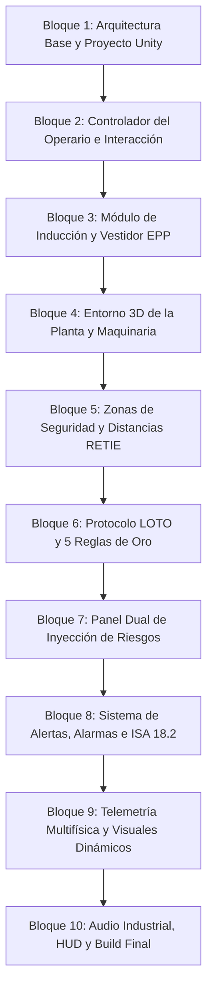

# Plan Maestro: Simulador Interactivo 3D de Planta Industrial (Molino de Granos) en Unity

**Proyecto:** Máquinas Eléctricas (Universidad de los Llanos — 2026-2)  
**Entorno Operativo:** AgroMolinos del Valle S.A.  
**Equipo Crítico:** Motor Trifásico de Inducción Jaula de Ardilla (10 HP, 460 V, 60 Hz, 4 polos, 1750 RPM) accionado por VFD  
**Marco Normativo de Seguridad:** RETIE (Art. 13, 20), NFPA 70E (Arc Flash), ISO 13857 (Distancias de seguridad de maquinaria), ISO 10816-1/3 (Vibraciones), NFPA 61 / ATEX (Polvo combustible de granos), OSHA 1910.147 / 5 Reglas de Oro (LOTO).

---

## 1. Visión General del Proyecto

Desarrollar un **Serious Game / Simulador 3D interactivo en Unity** donde el usuario asume el rol de un **operario industrial** en la planta de molienda de cereales. La experiencia combina simulación física rigurosa del accionamiento electromecánico (DTC / VFD acoplado a carga de molienda) con protocolos estrictos de seguridad industrial y salud en el trabajo.

El sistema evalúa el comportamiento del operario en tiempo real:
1. **Fase de Capacitación e Inducción**: Formación previa sobre riesgos eléctricos, mecánicos y de explosión por polvo.
2. **Vestidor y Protocolo EPP**: Obligación de equipar los Elementos de Protección Personal adecuados antes de acceder a la nave de producción.
3. **Respeto de Distancias y Zonas Críticas**: Límites de aproximación a tableros energizados (RETIE / NFPA 70E) y maquinaria en movimiento (ISO 13857).
4. **Enclavamientos e Interlocks**: Detección de apertura de compuertas con motor en marcha.
5. **Procedimiento LOTO (Lockout/Tagout)**: Aplicación secuencial de las 5 Reglas de Oro para intervención segura.
6. **Panel Dual de Simulación de Riesgos**: Inyección controlada de fallas tanto en la maquinaria (planta) como de infracciones por parte del operario (factor humano).
7. **Sistema Audiovisual de Alertas y Alarmas**: Baliza Andon 3D de 4 estados, sirenas espaciales, notificaciones HUD y panel SCADA según norma ISA 18.2.

---

## 2. Mapa de Bloques de Actividades (Roadmap Modular)

El desarrollo está organizado en **10 Bloques Modulares Independientes**. Cada bloque define sus objetivos, componentes a construir, entradas/salidas y criterios de aceptación, permitiendo su ejecución por partes a solicitud del usuario.

---

### Bloque 1: Arquitectura Base y Estructura del Proyecto Unity
- [x] **1.1 Configuración del Entorno de Proyecto**:
  - Definición de pipeline gráfico (Universal Render Pipeline - URP en `Packages/manifest.json`).
  - Estructuración del árbol de directorios estándar (`SimuladorPlanta3D/Assets/_Project/{Scripts, Scenes, Prefabs, Materials, UI, Audio, ScriptableObjects}`).
- [x] **1.2 Assembly Definitions (`.asmdef`)**:
  - `App.Core.asmdef`: Utilidades matemáticas, canales de eventos ScriptableObjects y tipos de datos base.
  - `App.Simulation.asmdef`: Ecuaciones dinámicas del motor (`InductionMotorPhysics.cs`), VFD (`VFDInverterController.cs`) y carga.
  - `App.Safety.asmdef`: Lógica de E-Stop, 5 Reglas de Oro LOTO, interlocks mecánicos y ATEX (`IndustrialSafetySystem.cs`).
  - `App.UI.asmdef`: HUD, panel de inyección de riesgos (`FaultInjector.cs`), baliza Andon (`AlarmAnnunciatorISA.cs`) y telemetría SCADA (`SCADATelemetryUI.cs`).
- [x] **1.3 Sistema de Entrada (Unity New Input System)**:
  - Paquete `com.unity.inputsystem` preconfigurado en manifiesto y referencias de ensamblados.
- [x] **1.4 Arquitectura de Canales de Eventos (ScriptableObjects)**:
  - Canales desacoplados creados: `VoidEventChannelSO`, `BoolEventChannelSO`, `FloatEventChannelSO`, `StringEventChannelSO`, `SafetyViolationEventChannelSO`.

---

### Bloque 2: Controlador del Operario y Sistema de Interacción
- [x] **2.1 Player Controller (Operario Industrial)**:
  - Movimiento físico con `CharacterController` (`PlayerController.cs`) con velocidades reglamentarias de planta (caminata 1.4 m/s, aceleración suave y cabeceo de cabeza / head bobbing).
  - Manejo de entradas con New Input System (WASD, ratón, Shift para paso ligero) con fallback automático.
  - Implementación de la Decisión Técnica **D1**: Perspectiva Híbrida (`CameraModeController.cs`) conmutable en tiempo real entre 1ª persona (FPS) y 3ª persona (TPS) con la tecla `[V]`, incluyendo sphere-cast anticolisión de cámara.
- [x] **2.2 Sistema de Interacción por Raycast**:
  - Detección precisa de objetos interactuables en retícula central con rango de alcance de 2.2 metros (`PlayerInteraction.cs`).
  - Interfaz desacoplada `IInteractable` para cualquier objeto accionable de la planta.
  - Componente genérico `InteractableTrigger.cs` para botones, manetas, interruptores y piezas de EPP con eventos y retroalimentación sonora/visual.
- [x] **2.3 HUD Base del Operario**:
  - Retícula central dinámica en `PlayerHUD.cs` (cambia de escala y color al enfocar elementos accionables).
  - Notificación contextual de interacción en pantalla (`[E] Abrir compuerta`).
  - Banner de alertas de seguridad animado (Toast) vinculado a `SafetyViolationEventChannelSO` para avisar de infracciones de normativas RETIE e ISO.

---

### Bloque 3: Módulo de Inducción, Capacitación y Vestidor EPP
- [x] **3.1 Zona de Vestidores / Locker Room**:
  - Sala previa al ingreso a la nave de molienda con casilleros y estanterías de seguridad.
  - Esclusa de seguridad (`AirlockSecurityDoor.cs`) con escáner óptico (luz roja/verde) que bloquea el paso hasta cumplir la inducción y el 100% del EPP.
- [x] **3.2 Sistema Modular de EPP (Equipos de Protección Personal)**:
  - Implementación de slots y lógica de inventario en `OperatorPPEInventory.cs` y objetos interactuables en 3D en `PPEInteractableItem.cs`:
    1. **Casco Dieléctrico Tipo 1 Clase E (20 kV)**.
    2. **Gafas de Seguridad con Protección Lateral (ANSI Z87.1)**.
    3. **Protectores Auditivos de Copa (NRR > 25 dB)**.
    4. **Botas de Seguridad Dieléctricas con Puntera**.
    5. **Guantes Dieléctricos Clase 0 (1000 V) / Mecánicos**.
    6. **Overol de Trabajo Antiestático / Antiflama**.
- [x] **3.3 Módulo de Inducción y Briefing Técnico**:
  - Terminal interactiva `SafetyInductionTerminal.cs` en vestidores que certifica la aprobación de la capacitación de seguridad antes de habilitar el turno.
- [x] **3.4 Esclusa de Acceso con Detección de Faltantes**:
  - Si el operario intenta ingresar sin EPP completo, se dispara una alarma sonora de acceso denegado y se notifica la falta específica por banner HUD.

---

### Bloque 4: Entorno 3D de la Planta de Molienda y Maquinaria
- [x] **4.1 Nave Industrial (AgroMolinos del Valle S.A.)**:
  - Piso de concreto epóxico industrial delimitado, líneas amarillas de advertencia y muro divisor entre vestidor y planta.
- [x] **4.2 Molino de Martillos Industrial (Hammer Mill)**:
  - Carcasa de molienda de fundición, rotor interno y compuerta de inspección con microswitch de seguridad.
- [x] **4.3 Motor Trifásico de Inducción (10 HP, 460 V)**:
  - Pedestal rígido, carcasa cilíndrica con aletas en color azul/cian NEMA y parámetros RETIE/IEC integrados en `InductionMotorPhysics.cs`.
- [x] **4.4 Centro de Control de Motores (CCM) y Tablero VFD**:
  - Gabinete NEMA en gris RAL 7035 con variador `VFDInverterController.cs` y lógica de seguridad `IndustrialSafetySystem.cs`.
- [x] **4.5 Sistema de Parada de Emergencia**:
  - Pulsador tipo hongo rojo E-Stop (`InteractableTrigger.cs`) en el gabinete con disparo de Categoría 0 (ISO 13850).

---

### Bloque 5: Zonas de Seguridad, Distancias Mínimas y Detección de Infracciones
- [x] **5.1 Zona Eléctrica de Tablero CCM (RETIE Art. 13 & NFPA 70E)**:
  - Volumen perimétrico `SafetyZoneTrigger.cs` que verifica la distancia mínima de aproximación por arco eléctrico (requiere guantes dieléctricos Clase 0 y casco).
- [x] **5.2 Zona Mecánica de Molienda (ISO 13857)**:
  - Perímetro de seguridad alrededor del molino en rotación; alerta si el operario ingresa sin gafas o sin protección auditiva.
- [x] **5.3 Enclavamiento de Seguridad en Compuerta (Safety Interlock Switch)**:
  - Si el operario abre la compuerta de martillos con el motor en movimiento ($N > 0\text{ RPM}$) $\rightarrow$ Parada de emergencia instantánea por Categoría 0 y violación crítica.
- [x] **5.4 Zona ATEX de Polvo Combustible (NFPA 61)**:
  - Detección de acumulación de polvo inflamable en suspensión con extractor apagado.

---

### Bloque 6: Procedimiento LOTO (Lockout / Tagout) & 5 Reglas de Oro
- [x] **6.1 Lógica de Estados LOTO (IndustrialSafetySystem.cs)**:
  - Registro de las 5 Reglas de Oro: Parada operativa $\to$ Corte visible $\to$ Bloqueo con candado $\to$ Etiquetado $\to$ Verificación de energía cero.
- [x] **6.2 Prevención de Intervención con Energía**:
  - Si se intenta maniobra en motor sin certificación LOTO $\rightarrow$ Rechazo de acción y registro de falta grave.

---

### Bloque 7: Panel Dual de Inyección de Riesgos (Planta vs Operario)
- [x] **7.1 Interfaz de Tablet de Campo ([Tab])**:
  - `RiskControlTabletUI.cs` accesible en cualquier punto de la planta abriendo la PDA con la tecla `[Tab]` y liberando el cursor para interactuar.
- [x] **7.2 Riesgos de la Planta (Fallas Electromecánicas)**:
  - Botones funcionales para simular atasco en tolva ($175\%$ par), pérdida de fase L3 (single-phasing), falla severa en rodamientos (ISO 10816 Zona D), bloqueo térmico de ventilación y falla del ciclón extractor (ATEX).
- [x] **7.3 Riesgos del Operario (Infracciones de Seguridad)**:
  - Simulación de despojo de EPP, forzado de compuerta en marcha e intento de intervención bajo tensión sin LOTO.

---

### Bloque 8: Sistema Integral de Alertas, Alarmas e ISA 18.2
- [x] **8.1 Baliza Andon 3D de 4 Estados**:
  - Torre de luces `AlarmAnnunciatorISA.cs` con animación emisiva (Verde: Normal, Amarillo: Alerta, Rojo: Parada/Disparo, Azul: LOTO).
- [x] **8.2 Notificaciones HUD (Toast)**:
  - Banner dinámico superior en `PlayerHUD.cs` con código de norma (RETIE, ISO, OSHA, NFPA) y descripción del peligro.

---

### Bloque 9: Telemetría Multifísica y Visuales Dinámicos
- [ ] **9.1 Acoplamiento con Scripts C# Existentes**:
  - Integración de `InductionMotorPhysics.cs` (modelo de Kloss, pérdidas en el cobre/hierro, ecuación térmica diferencial $dT/dt$, vibración según ISO 10816).
  - Integración de `VFDInverterController.cs` (control escalar V/f con rampa de aceleración/desaceleración, cálculo de potencia activa en kW y consumo acumulado en kWh).
- [ ] **9.2 Animaciones y Cinética en Tiempo Real**:
  - Rotación física del eje del motor, poleas y martillos del molino ligada directamente a la velocidad angular calculada ($N$ RPM).
  - Efecto procedural de vibración sobre el chasis del motor mediante ruido Perlin / oscilador armónico en `transform.localPosition`, escalado por la vibración RMS ($V_{RMS}$).
- [ ] **9.3 Efectos de Partículas Industriales**:
  - Caída de granos en la tolva proporcional a la tasa de alimentación.
  - Polvo suspendido en el ambiente de molienda modulado por el estado del ciclón extractor.
  - Humo térmico de devanados cuando la temperatura supera los $110^\circ\text{C}$.
  - Chispazo de arco eléctrico si se produce maniobra indebida en el CCM.
- [ ] **9.4 Instrumentación Virtual en Pantalla (Gauges e Indicadores)**:
  - Cuadrantes analógicos de aguja y displays digitales de 7 segmentos: Voltímetro (460 V), Amperímetros de fase (IA, IB, IC), Tacómetro (RPM), Frecuencímetro (Hz), Termómetro (°C) y Vibrómetro (mm/s).

---

### Bloque 10: Audio Industrial, HUD de Desempeño y Compilación Final
- [ ] **10.1 Mezcla de Audio y Entorno Sonoro Industrial**:
  - Loop ambiental de fondo de nave de procesamiento agroindustrial.
  - Zumbido magnético de inducción a 60 Hz modulado en frecuencia y volumen según los Hz del VFD y la carga.
  - Sonido de impacto de martillos triturando cereal modulado por el caudal de grano.
  - Silbido característico de conmutación PWM del inversor VFD a 4 kHz.
  - Filtro pasa-bajos dinámico (Audio Low-Pass Filter) que se activa automáticamente al equiparse los protectores auditivos de copa, simulando la atenuación acústica real del operario.
- [ ] **10.2 Sistema de Calificación y Reporte del Operario**:
  - Contador de infracciones de seguridad, tiempo de respuesta ante alarmas y cumplimiento de EPP.
  - Pantalla final de evaluación con dictamen de aptitud operativa según normatividad RETIE/OSHA.
- [ ] **10.3 Menú Principal y Opciones**:
  - Menú de bienvenida con selección de modo: **Modo Capacitación Guiada** o **Modo Sandbox de Pruebas Libres**.
  - Ajustes de gráficos, volumen de audio y sensibilidad de ratón.
- [ ] **10.4 Optimización y Build Ejecutable**:
  - Baking de iluminación estática para nave y luces dinámicas para balizas Andon.
  - Generación de build ejecutable independiente para Windows 64-bit (`AgroMolinos_Simulator_3D.exe`).

---

## 3. Matriz de Decisiones de Arquitectura y Diseño (Concertadas)

Las siguientes definiciones técnicas de arquitectura y experiencia han sido aprobadas:

| # | Decisión Técnica | Opción Seleccionada | Justificación / Impacto en el Diseño |
|---|---|---|---|
| **D1** | **Perspectiva y Control del Operario** | **Perspectiva Híbrida (FPS/TPS conmutable con `V`)** | Operación de tableros, pulsadores y candados con retícula precisa en primera persona, con espejo/estación en vestidor y cámara conmutable para visualizar al operario con sus prendas de seguridad puestas. |
| **D2** | **Acceso al Panel de Simulación de Riesgos** | **Sistema Dual Integrado (Estación SCADA fija + Tablet portátil `[Tab]`)** | Permite inyectar riesgos desde el puesto formal de supervisión en sala de control o directamente sobre el terreno junto a la maquinaria con la tablet en mano. |
| **D3** | **Flujo Inicial de la Simulación** | **Modo Inducción Guiado Obligatorio** | La esclusa electromagnética hacia la nave de producción bloquea el paso hasta que el operario complete el briefing de seguridad y vista el 100% del EPP requerido. |
| **D4** | **Pipeline Gráfico de Unity** | **Universal Render Pipeline (URP)** | Máxima calidad visual industrial con materiales PBR metálicos, iluminación LED cenital en tiempo real, efectos volumétricos de polvo ATEX y excelente rendimiento. |
| **D5** | **Construcción de Modelos 3D** | **Generación Modular Nativa con Texturizado PBR** | Ensamble procedural y modular dentro de Unity (con capacidad de reemplazo/acople para modelos FBX/CAD externos). |

---

## 4. Próximo Paso Inmediato

Una vez revisado y aprobado este plan maestro, el usuario indicará con cuál bloque desea comenzar (típicamente **Bloque 1: Configuración de Proyecto y Arquitectura** o **Bloque 2: Controlador del Operario**), resolviendo las decisiones de diseño presentadas.
